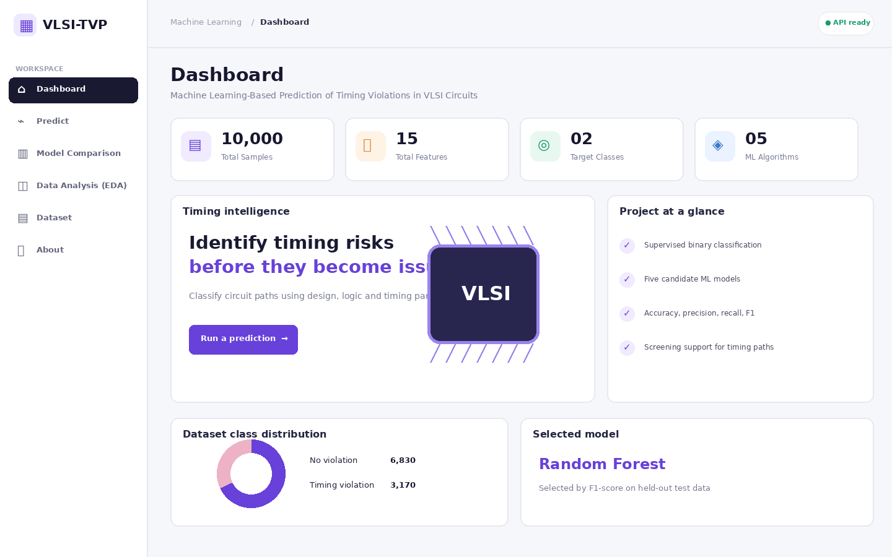
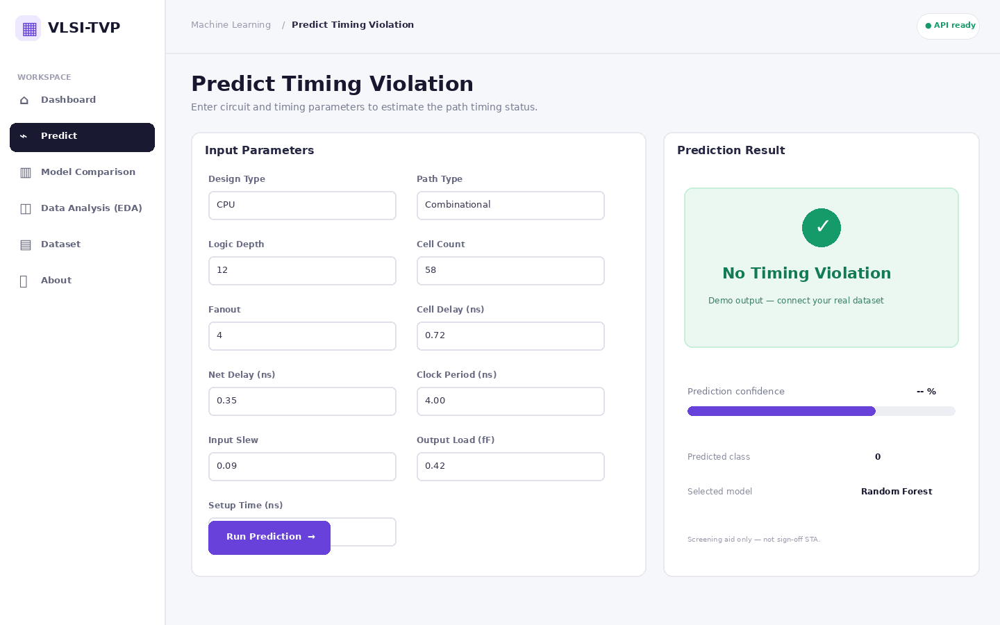
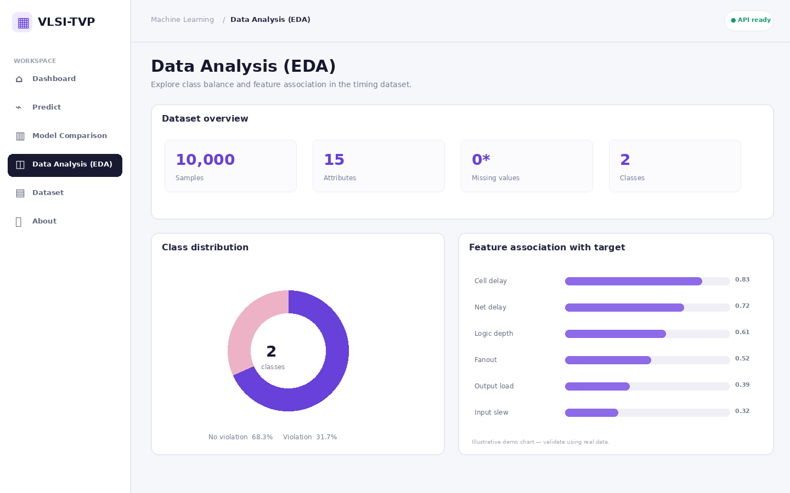
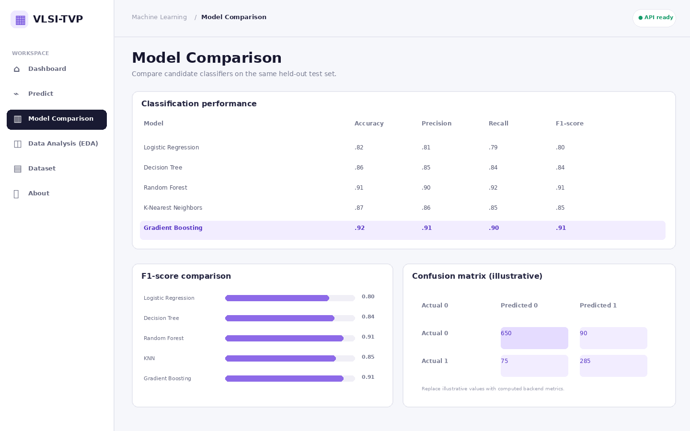
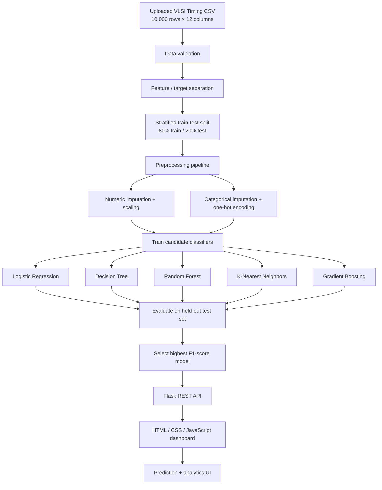
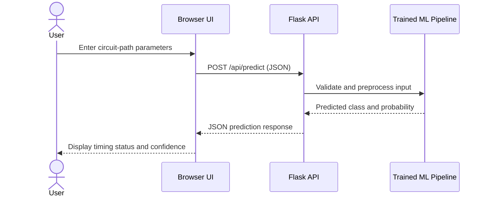

<div align="center">

# VLSI-TVP
### Machine Learning-Based Prediction of Timing Violations in VLSI Circuits

**An interactive AIML web application for analysing circuit-path parameters and predicting timing-violation risk.**


</div>

---

## ✨ Project at a glance

VLSI-TVP is a full-stack machine-learning application that uses circuit and timing attributes to classify a path as **Timing Violation (1)** or **No Timing Violation (0)**. The web interface provides dataset insights, an interactive prediction form, model benchmarking, and exploratory data analysis.

| Dataset facts | Value |
|---|---:|
| Records | **10,000** |
| Total CSV columns | **12** |
| Input features | **11** |
| Target classes | **2** |
| Missing values in uploaded CSV | **0** |
| No timing violation (`0`) | **6,788 (67.88%)** |
| Timing violation (`1`) | **3,212 (32.12%)** |
| Design categories | **8** |
| Path categories | **3** |

> **Data integrity:** The repository includes the CSV supplied for this project. The application reads `data/vlsi_timing_dataset.csv` directly. Model metrics shown in the running app are computed from this dataset using a stratified 80:20 train/test split; they are not hard-coded sample scores.

## 🖥️ Application preview

| Dashboard | Timing prediction |
|:--:|:--:|
|  |  |
| **Dataset overview, class balance and best model** | **Enter circuit parameters and receive a model prediction** |

| Exploratory data analysis | Model comparison |
|:--:|:--:|
|  |  |
| **Class distribution and feature association** | **Compare accuracy, precision, recall and F1-score** |

## 🧠 Problem statement

Timing analysis is essential to ensure that signals in a digital circuit reach their destination within the required timing constraints. A timing violation can affect correct data capture and overall circuit reliability.

This project explores a supervised machine-learning approach that learns patterns from circuit-path attributes and predicts whether a path belongs to the timing-violation class. The application is intended as an educational decision-support prototype and does not replace Electronic Design Automation (EDA) tools or sign-off Static Timing Analysis (STA).

## 🎯 Objectives

- Prepare and analyse the supplied VLSI timing dataset.
- Build a preprocessing pipeline for numerical and categorical attributes.
- Train and compare multiple supervised classification algorithms.
- Evaluate models using accuracy, precision, recall, F1-score and a confusion matrix.
- Provide a web form to predict the timing status of a new circuit path.
- Present dataset and model insights through a responsive dashboard.

## 🏗️ System architecture



### Request / prediction flow



## 🧰 Technology stack

| Layer | Technology | Usage |
|---|---|---|
| Frontend structure | HTML5 | Dashboard pages, forms, tables |
| Frontend styling | CSS3 | Responsive layout, cards, navigation |
| Frontend behaviour | JavaScript (Fetch API) | Navigation, form handling, API integration |
| Backend | Python 3 | Application and ML logic |
| Web framework | Flask | REST endpoints and page serving |
| Data processing | Pandas | CSV loading and tabular operations |
| Numerical computing | NumPy | Numerical operations |
| ML framework | Scikit-learn | Preprocessing, training, evaluation and inference |
| WSGI server | Gunicorn | Production application server |
| Hosting configuration | Render | Python web-service deployment |
| Version control | Git and GitHub | Source control and project hosting |

## 📊 Dataset description

**File:** `data/vlsi_timing_dataset.csv`

The dataset contains 10,000 records, 11 predictor features and one binary target column. The original CSV has no missing values.

### Input features

| Feature | Type | Description |
|---|---|---|
| `design_type` | Categorical | Circuit design category |
| `path_type` | Categorical | Timing path category |
| `logic_depth` | Numerical | Number of logic levels |
| `cell_count` | Numerical | Number of cells in the path |
| `fanout` | Numerical | Number of loads driven |
| `cell_delay_ns` | Numerical | Cell delay in nanoseconds |
| `net_delay_ns` | Numerical | Net/interconnect delay in nanoseconds |
| `clock_period_ns` | Numerical | Clock period in nanoseconds |
| `input_slew_ns` | Numerical | Input transition slew in nanoseconds |
| `output_load_pf` | Numerical | Output load in picofarads |
| `setup_time_ns` | Numerical | Setup time in nanoseconds |

### Categorical values found in the CSV

- **Design types:** ALU, Multiplier, UART, Adder, Counter, FSM, FIFO, SPI.
- **Path types:** `reg_to_reg`, `in_to_reg`, `reg_to_out`.

### Target variable

| Value | Meaning | Records |
|---:|---|---:|
| `0` | No Timing Violation | 6,788 |
| `1` | Timing Violation | 3,212 |

The target is moderately imbalanced. Therefore, the project reports precision, recall and F1-score in addition to accuracy. Recall for class `1` is particularly useful to inspect because false negatives represent missed timing violations.

## ⚙️ Machine-learning methodology

1. **Load and validate:** Read the project CSV and verify required columns and binary target labels.
2. **Separate features and target:** Use the 11 input features to predict `timing_violation`.
3. **Split data:** Stratified 80:20 train/test split with a fixed random seed (`42`).
4. **Preprocess numerical features:** Median imputation and standard scaling.
5. **Preprocess categorical features:** Most-frequent imputation and one-hot encoding with unknown-category handling.
6. **Train classifiers:** Fit five candidate models on the training set.
7. **Evaluate:** Calculate metrics using the held-out test set.
8. **Select:** Choose the model with the highest test-set F1-score for the prediction API.
9. **Infer:** Apply the same fitted preprocessing and selected model to new form input.

### Algorithms compared

| Algorithm | Purpose |
|---|---|
| Logistic Regression | Linear classification baseline |
| Decision Tree | Interpretable rule-based classifier |
| Random Forest | Ensemble of decision trees |
| K-Nearest Neighbors | Distance-based classifier |
| Gradient Boosting | Sequential boosting classifier |

### Evaluation metrics

- **Accuracy:** Overall fraction of correct predictions.
- **Precision:** Of paths predicted as violations, how many are actual violations?
- **Recall:** Of actual violations, how many did the model detect?
- **F1-score:** Harmonic mean of precision and recall.
- **Confusion matrix:** Shows true/false positives and true/false negatives.

The application calculates and displays the real scores at startup. No score is claimed in this README because model performance should be read from the running evaluation against the included dataset.

## 🧩 Application modules

| Module | Functionality |
|---|---|
| Dashboard | Dataset totals, class distribution and selected model |
| Predict | Input circuit/timing parameters and get a live prediction |
| Model Comparison | Compare five models and inspect the best model's confusion matrix |
| Data Analysis (EDA) | Class distribution and numerical feature association |
| Dataset | Feature dictionary and target-label details |
| About | Problem statement, objectives and technology stack |

## 🔌 REST API

| Method | Endpoint | Purpose |
|---|---|---|
| `GET` | `/api/dashboard` | Dataset summary and class counts |
| `GET` | `/api/analysis` | Class distribution and feature associations |
| `GET` | `/api/models` | Model metrics and confusion matrix |
| `POST` | `/api/predict` | Predict timing status for a circuit path |

### Example prediction request

```json
{
  "design_type": "ALU",
  "path_type": "reg_to_reg",
  "logic_depth": 26,
  "cell_count": 55,
  "fanout": 5,
  "cell_delay_ns": 2.05,
  "net_delay_ns": 0.43,
  "clock_period_ns": 4.0,
  "input_slew_ns": 0.305,
  "output_load_pf": 0.60,
  "setup_time_ns": 0.224
}
```

### Example response shape

```json
{
  "prediction": 0,
  "label": "No Timing Violation",
  "confidence": 91.2,
  "model": "Random Forest",
  "note": "ML screening estimate; confirm critical paths using sign-off Static Timing Analysis."
}
```

*The response values above illustrate the API format only. Actual values are generated by the trained model.*

## 🚀 Run locally

### 1. Prerequisites

- Python 3.10 or newer
- Git
- VS Code or another code editor

### 2. Clone the repository

```bash
git clone https://github.com/<YOUR_USERNAME>/VLSI-Timing-Violation-Prediction.git
cd VLSI-Timing-Violation-Prediction
```

### 3. Create a virtual environment

**Windows PowerShell:**

```powershell
python -m venv .venv
.venv\Scripts\Activate.ps1
```

**macOS / Linux:**

```bash
python3 -m venv .venv
source .venv/bin/activate
```

### 4. Install dependencies

```bash
pip install --upgrade pip
pip install -r requirements.txt
```

### 5. Start the application

```bash
python app.py
```

Open the application in your browser:

```text
http://127.0.0.1:5000
```

**First startup:** the application reads the CSV, trains five models and evaluates them. Wait for the Flask server to report that it is running before opening the website.

## ☁️ Deploy on GitHub + Render

GitHub stores the source code and dataset. Render hosts and runs the Python application. GitHub Pages alone cannot run this Flask/ML backend.

### Step 1 — Create a GitHub repository

Create a repository named:

`VLSI-Timing-Violation-Prediction`

Keep it public if you want recruiters, faculty or teammates to view the project.

### Step 2 — Upload / push the project

From the project root:

```bash
git init
git add .
git commit -m "Initial commit: VLSI timing violation predictor"
git branch -M main
git remote add origin https://github.com/<YOUR_USERNAME>/VLSI-Timing-Violation-Prediction.git
git push -u origin main
```

### Step 3 — Create a Render web service

1. Sign in to [Render](https://render.com/).
2. Select **New → Web Service**.
3. Connect your GitHub account and select this repository.
4. Render reads the included `render.yaml`. If it asks for manual settings, use:

| Setting | Value |
|---|---|
| Runtime | Python |
| Build command | `pip install -r requirements.txt` |
| Start command | `gunicorn app:app` |

5. Select **Deploy Web Service**.
6. Wait for installation and model training to finish.
7. Open the Render URL and test Dashboard, Model Comparison and Predict.

### Step 4 — Verify the deployment

- Dashboard should report 10,000 records and 11 input features.
- Class counts should show 6,788 and 3,212.
- Model Comparison should show five computed models.
- Submit a prediction using values from the dataset's feature ranges.
- Confirm the API endpoint `/api/dashboard` returns JSON.

> **Deployment note:** This app trains the models when the web process starts. Initial deployment can take longer than a static website. For larger datasets or multiple web workers, train once and persist a model artifact instead of retraining on every worker startup.

## 📁 Repository structure

```text
VLSI-Timing-Violation-Prediction/
│
├── app.py
├── requirements.txt
├── render.yaml
├── README.md
├── .gitignore
│
├── data/
│   └── vlsi_timing_dataset.csv
│
├── ml/
│   ├── __init__.py
│   └── pipeline.py
│
├── templates/
│   └── index.html
│
├── static/
│   ├── style.css
│   └── app.js
│
└── screenshots/
    ├── 01_dashboard.png
    ├── 02_prediction.png
    ├── 03_data_analysis.png
    └── 04_model_comparison.png
```

## 👥 Project team

| Name | PRN | Branch |
|---|---|---|
| Aditi Bhavar | 202401070034 | ENTC |
| Tanish Rayalkar | 202401070062 | ENTC |
| Akshay Naik | 202401070063 | ENTC |
| Vishwambhar Kinage | 202401070069 | IT |

**Project Guide:** Anita Shingarde

## 🔭 Future scope

- Add upload-and-validate support for new timing datasets.
- Add ROC-AUC and precision-recall curves.
- Add SHAP-based feature explanations.
- Save the trained pipeline and separate training from web startup.
- Add prediction history and downloadable reports.
- Validate predictions against STA reports and additional circuit designs.

## ⚠️ Limitations

- Model quality depends on the representativeness and labelling quality of the supplied dataset.
- A model confidence score is not a guarantee of correctness.
- Correlation and feature association do not establish causality.
- This is an academic ML prototype, not an EDA sign-off tool. Always validate critical paths with the appropriate STA flow.

---

<div align="center">

**VLSI-TVP · AIML MDM Mini Project**

*Machine Learning × VLSI Timing Analysis*

</div>
